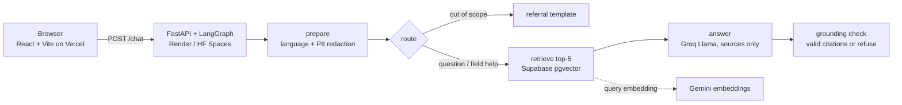

# FormWise

*An unofficial AI guide to the German residence registration (Anmeldung).*

> **Unofficial student project. Not legal advice, not affiliated with or endorsed by any authority or university. Do not enter real personal data.**

An AI assistant that helps people **understand and fill in one public-service form**: the German residence registration (*Anmeldung*, Meldeschein under § 23 Bundesmeldegesetz). It answers in **English or German**, **only from official public sources**, and cites the source of every statement.

**Live demo:** _add Vercel URL_ · **Demo video/GIF:** _add_

## Why

Administrative forms are designed for the authority, not the citizen. Newcomers to Germany meet the Anmeldung in their first two weeks, often before they speak German, and the rules are spread across a federal statute and city service portals. This project tests a narrow question: *can a small, grounded conversational agent make one form understandable without inventing rules?*

## What it does

- **Chat** (EN/DE): answers questions about the Anmeldung from the Bundesmeldegesetz and the Berlin service portal, with numbered citations and quoted source excerpts.
- **Refuses instead of guessing.** It replies "I don't know, check with your Bürgeramt" when the sources don't cover a question, when the answer has no valid citation, or when the best match is too weak. Out-of-scope questions (visas, taxes, other forms) are redirected.
- **Form walkthrough.** It explains each field of the form in plain language, says *why* each field is asked (with a link to the legal basis), and has an "ask about this field" button for context-aware help.
- **Privacy by design.** There are no accounts and no chat logs. Practice entries never leave the browser, and a PII filter redacts IBANs, tax IDs, emails, phone numbers, document numbers and birth dates before anything reaches the LLM.

## Architecture



| Layer | Choice | Cost |
|---|---|---|
| Frontend | React + Vite + TypeScript, Vercel | free |
| Backend | FastAPI + LangGraph, Docker on Render or Hugging Face Spaces | free |
| LLM | Groq (`llama-3.3-70b-versatile` for answers, `llama-3.1-8b-instant` for routing) | free tier |
| Embeddings | Gemini `gemini-embedding-001`, 768 dims, multilingual | free tier |
| Vector store | Supabase Postgres + pgvector, RLS on, no public access | free tier |

## Knowledge sources

All content comes from official public sources (see [`ingest/sources.yaml`](ingest/sources.yaml), retrieved 2026-10-24):

- **Bundesmeldegesetz** §§ 3, 17, 19, 21, 22, 23, 27, 54 from [gesetze-im-internet.de](https://www.gesetze-im-internet.de/bmg/). German statutes are not protected by copyright (§ 5 UrhG).
- **Service-Portal Berlin**: [Wohnsitz anmelden](https://service.berlin.de/dienstleistung/120686/). Only a few sections are used (requirements, documents, fees, legal basis), always with attribution and a link back.

The sources are in German. English answers are translations by the model, and the original German excerpt is shown with every citation so users can check it.

## Evaluation

[`eval/questions.jsonl`](eval/questions.jsonl) holds 28 in-scope questions (EN + DE) with the expected source, plus 4 out-of-scope questions.

| Metric | Result |
|---|---|
| Retrieval hit@5 | _run `python eval/run_eval.py`_ |
| Answered with valid citations | _run with `--full`_ |
| Out-of-scope correctly refused | _run with `--full`_ |

## Run it locally

```bash
# 1. Database: create a free Supabase project, then run supabase/migrations/001_init.sql in the SQL editor
# 2. Backend
python -m venv .venv && source .venv/bin/activate
pip install -r backend/requirements-dev.txt -r ingest/requirements.txt
cp backend/.env.example backend/.env        # add Groq, Gemini and Supabase keys
python ingest/fetch.py && python ingest/chunk.py && python ingest/embed_upload.py
cd backend && pytest -q && uvicorn app.main:app --reload --port 8000
# 3. Frontend
cd frontend && cp .env.example .env && npm install && npm run dev
```

## Limitations

- Covers **one** form and **one** city's portal. Local practice differs between municipalities.
- The form schema is a simplified view of the Meldeschein fields defined in § 3 BMG. Your Bürgeramt's form may look different.
- Free-tier LLM and hosting: the first request after idle can take ~30 s, and rate limits apply.
- The PII filter is pattern-based. It is a safety net, not a guarantee.
- Not tested with real users yet. A small usability study is the obvious next step.

## Relation to research

This project builds on ideas from research on conversational agents for administrative form-filling at Universität Koblenz, in particular:

> O. Klass, J. Ibrahim, I. Straub, S. Kolekar, S. Bahle, M. Theiß, J. Wecker, G. Veith, T. Jaeger, M. A. Wimmer. *Supporting Patients in Administrative Form-Filling through Conversational Agents: A Case from an Orthopedic Technology Provider.* AI4DPS 2025 (Artificial Intelligence for Digital Public Services), STAF 2025, Koblenz, June 2025. [Programme page](https://conf.researchr.org/details/staf-2025/ai4dps-2025-papers/19/Supporting-Patients-in-Administrative-Form-Filling-through-Conversational-Agents-A-C)

It also relates to the research-internship topic *"Chatbot for AI-based form-filling help"* offered by Prof. Wimmer's research group in winter semester 2024/25. This repository is independent work and is not affiliated with that group.

## License

Code: MIT. Source texts belong to their respective publishers; see [DISCLAIMER.md](DISCLAIMER.md).
